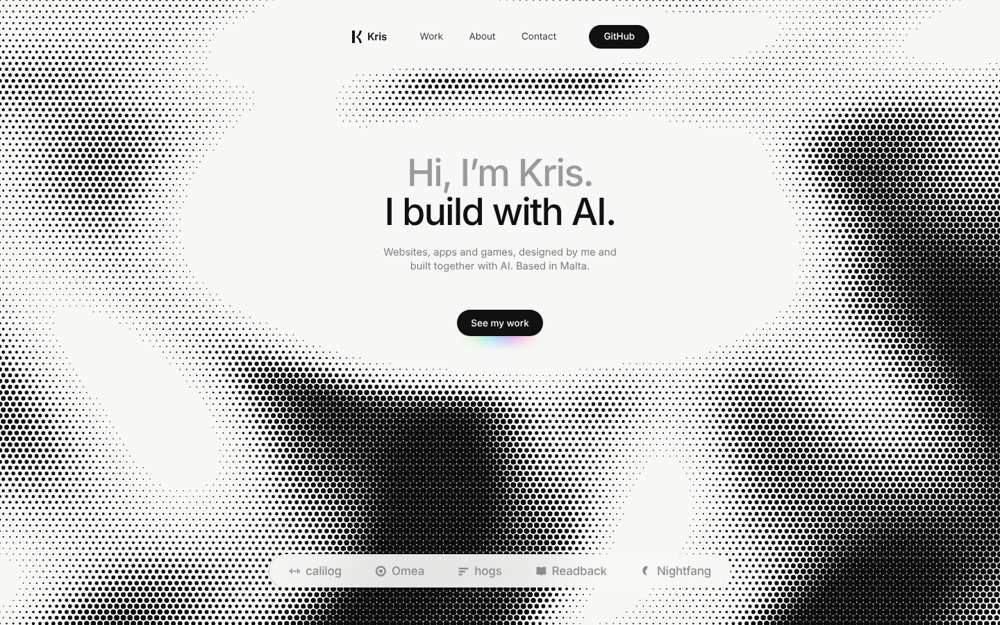

# Kris — I build with AI

Personal portfolio of **Kris**. Websites, apps and games, designed by me and built together with AI. Based in Malta.

**Live site: [personal-portfolio-six-kappa-65.vercel.app](https://personal-portfolio-six-kappa-65.vercel.app/)**

## Selected work

| Project | What it is | Status |
|---|---|---|
| **calilog** | A workout tracker for logging training sessions, running on my own virtual machine. | Live |
| **Omea** | The website for my family's cake business. I built it so the business has a home online. [tortiomea.com](https://tortiomea.com) | Live |
| **[hogs](https://github.com/Minior4eto/hogs)** | A tiny terminal app that shows what's hogging your disk. Sorted by size, with themes you can edit live. Written in Rust. | Open source |
| **[jrice](https://github.com/Minior4eto/japan-rice)** | Animated Japan-themed scenes for your terminal (temple, great wave, samurai, koi, snowy shrine, lighthouse, rainy neon alley), with ASCII and braille-dot modes and terminal theme sync. Written in Rust. | Open source |
| **[Wanderspace](https://wanderspace.vercel.app/)** | One philosophical YouTube video each day, under 25 minutes, with a question to carry and a private reflection space. | Live |
| **Readback** | An app where you hand it a book and it reads it to you. | Built |
| **Nightfang** | A Roblox game I'm working on right now. | In development |

## Lab

A separate page ([`lab.html`](lab.html)) covering my virtual machine setup: VirtualBox, UTM and QEMU, an OpenBSD server running calilog, a hardened iDeal OS install, and a shelf of distros I've tried.

## About

Bulgarian, living in Malta, building a bit of everything.

I don't write code by hand. I'm very good at working with AI: I decide what to build, shape how it looks and feels, and push it until it works and ships.

I'm open to jobs, freelance projects and collaborations, especially anything where fast, practical building with AI is the point.

## Contact

- GitHub: [@Minior4eto](https://github.com/Minior4eto)

## About this site

- Two static pages (`index.html` and `lab.html`) with plain HTML, CSS and vanilla JavaScript. No build step and no dependencies apart from the Inter font from Google Fonts.
- The hero art is a canvas of flowing halftone dots drawn in code. The dots react to the cursor, and visitors with reduced motion turned on get a still frame.
- Hosted on Vercel and redeployed automatically on every push to `main`.
- Designed and built together with AI.

To run it locally, open `index.html` in a browser.
